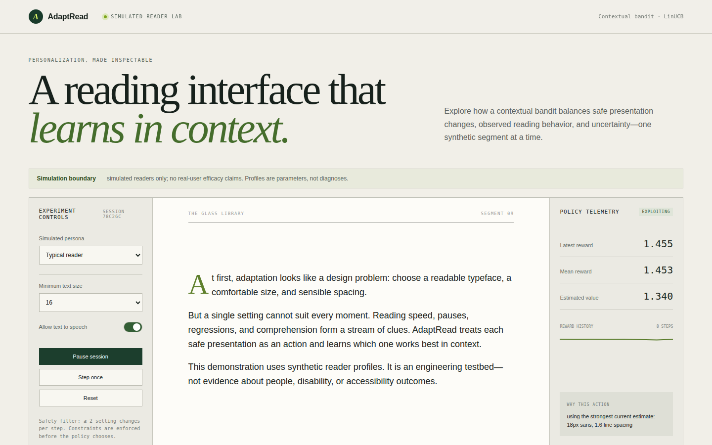

# AdaptRead

AdaptRead explores a narrow question: how can a contextual-bandit policy choose
the next safe reading presentation from recent observable behavior?

**[Try the live demo](https://boywithabot.com/projects/adaptread/)** ·
[Case study](https://boywithabot.com/projects/project-details.html?id=adaptread) ·
[Full results](results/README.md)



The project uses **simulated readers only**. It is not a clinical tool, a
human-subject study, or evidence that any presentation improves outcomes for
real readers. Synthetic personas are explicit parameter sets used to test
software and experimental methods.

## What it found

One context-free UCB1 policy trained across four simulated reader personas
cannot serve readers whose best presentations conflict: its mean regret stayed
high on the specialized profiles. A contextual LinUCB policy lowered mean regret
for all six evaluated profiles, including two held out from training:

| Simulated profile | Mixed UCB1 | LinUCB |
|---|---:|---:|
| Typical | 1.795 | 0.691 |
| Phonological | 17.154 | 9.614 |
| Low vision | 7.218 | 5.760 |
| Audio support | 3.434 | 0.956 |
| Focus chunks (held out) | 7.072 | 4.567 |
| Large text (held out) | 6.441 | 4.993 |

This is a positive but mixed result. Regret remains substantial on the two most
specialized training profiles and both held-out profiles, and nothing in this
synthetic result establishes benefit for real readers. The
[results](results/README.md) record seeds, parameters, and per-persona detail.

## Completed milestones

1. **Repository foundation:** Python 3.12, a `src/` package layout, locked
   dependencies, Ruff, strict mypy, pytest, MIT licensing, and GitHub Actions.
2. **Presentation domain:** immutable six-field actions, six coherent presets,
   a 22-value action encoding, and hard user constraints.
3. **Bounded reward:** separately testable comprehension, normalized speed,
   strain, and switch-cost terms, each clipped before weighting.
4. **Reader simulator:** seeded observable behavior, latent fatigue, episode
   termination, four training personas, and two held-out personas.
5. **Baselines and episode runner:** one agent contract and one training loop
   shared by random, fixed-default, and exhaustive fixed-preset oracle agents.
6. **UCB1:** a context-free learned policy with action masks, frozen
   evaluation, deterministic tie sampling, and JSON-safe state.
7. **Mixed-reader experiment:** four specialist UCB1 policies are compared
   against one policy trained across all four training personas.
8. **Contextual LinUCB:** one ridge-regression model per preset uses a
   documented 29-dimensional context and Sherman–Morrison inverse updates.
9. **Reproducible evaluation:** validated YAML, multiple training seeds,
   paired evaluation seeds, bootstrap intervals, held-out regret, and plots.
10. **Policy artifacts:** schema-versioned JSON stores model parameters,
    configuration hash, seeds, timestamp, and evaluation summary—never pickle.
11. **Policy service:** FastAPI clones the trained policy per bounded, locked
    session and exposes steps, traces, health, simulator data, and metrics.
12. **React demonstration:** a Vite/TypeScript client shows the readable pane,
    persona and constraints, telemetry, rewards, exploration, and explanations.
13. **Production packaging:** a multi-stage Docker image serves the built React
    app and API together, with container and platform health checks, a Render
    Blueprint, and a deployment smoke test.

## Setup

Install Python 3.12 and [uv](https://docs.astral.sh/uv/), then run:

```bash
uv sync --all-extras
uv run ruff check .
uv run mypy
uv run pytest
```

Verify that the installed package works outside the repository:

```bash
cd /tmp
uv run --project /path/to/AdaptRead python -c \
  "import adaptread; print(adaptread.__version__)"
```

## Architecture

```text
src/adaptread/
├── domain/        presentation actions, user constraints, and the bounded reward
├── simulator/     the simulated reader environment and personas
├── agents/        random, fixed, and oracle baselines; UCB1; LinUCB
├── experiments/   configuration, evaluation, and comparison runners
└── api/           FastAPI service, policy loading, and demo sessions
frontend/          React demonstration
tests/             pytest suite
configs/           experiment configurations
docs/              design notes and images
artifacts/         versioned policy artifacts
```

## Run the demonstration

Start the API:

```bash
uv run adaptread-api
```

In a second terminal:

```bash
cd frontend
npm ci
npm run dev
```

Open `http://localhost:5173`. The API is the single source of truth for presets
and synthetic persona parameters. The UI labels the simulation boundary near
the title and inside the reading passage.

## React demonstration walkthrough

The client turns the policy loop into an inspectable interface: current
presentation, hard constraints, reward history, estimated value, exploration
status, and a plain-language reason for each action. Its API types are generated
from FastAPI's OpenAPI schema. Component and Playwright tests exercise the
simulator-only labeling and a complete session step.

Run the comparison with:

```bash
uv run adaptread-experiment configs/portfolio.yaml --output results/portfolio
```

After this milestone, you should be able to answer:

1. Which UI elements expose exploration rather than hiding it?
2. Why does the browser fetch presets and persona parameters from the API?
3. Where does the interface state that the behavior is simulated?

## Production deployment

Build and exercise the production image locally when Docker is available:

```bash
docker build --tag adaptread .
docker run --rm --publish 8000:8000 adaptread
python scripts/smoke_deployment.py http://127.0.0.1:8000
```

The multi-stage image compiles the frontend with Node, installs only the Python
runtime package in the final image, copies the versioned policy artifact, and
serves both surfaces through Uvicorn. The container health check and Render's
`healthCheckPath` both use `GET /healthz`.

The public demo runs at
[boywithabot.com/projects/adaptread](https://boywithabot.com/projects/adaptread/).
To host your own copy, create a Render Blueprint from this repository and approve
the GitHub connection. [`render.yaml`](render.yaml) provisions one free Docker
web service and deploys only after repository checks pass. Free Render services
can spin down while idle and use an ephemeral filesystem, which is compatible
with AdaptRead's intentionally in-memory synthetic sessions but unsuitable for
durable real-user state.

After deployment, verify the public URL. This checks the live demo; replace
the URL to check your own deployment:

```bash
python scripts/smoke_deployment.py https://boywithabot.com/projects/adaptread
```

Production teach-back:

1. Why is the frontend built in a separate Docker stage?
2. What makes session loss after a restart an explicit design choice here?
3. Why does the Blueprint wait for checks before deploying a commit?

MIT licensed.
